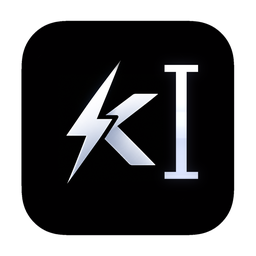
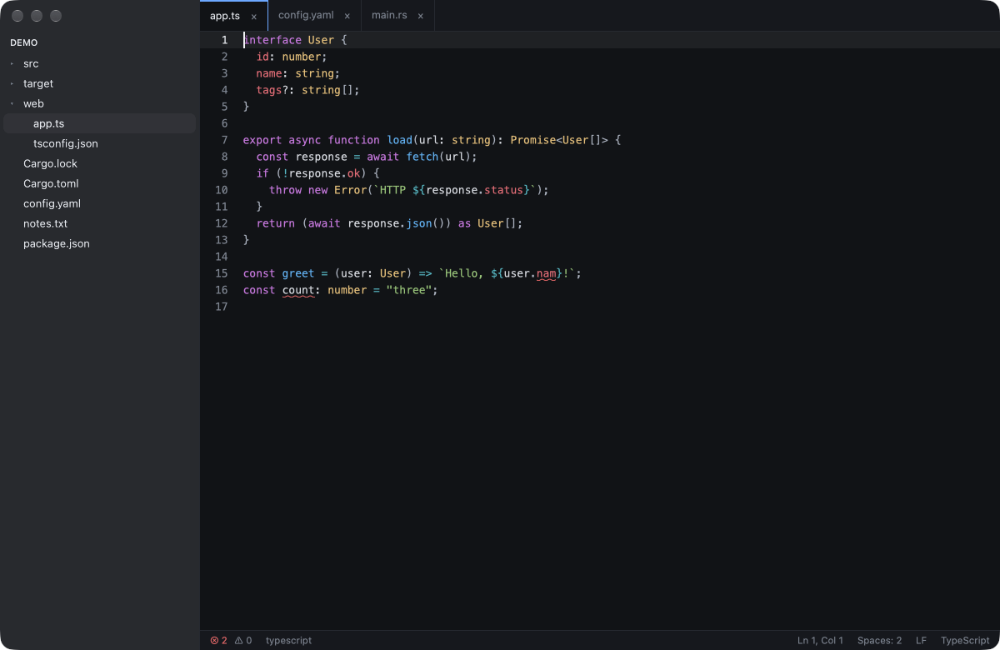
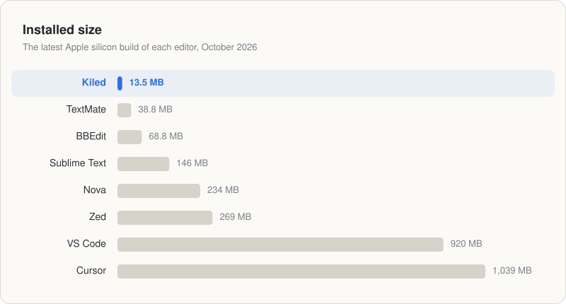

<p align="center">
  
</p>

<h1 align="center">Kiled</h1>

[](https://github.com/timwuhaotian/kiled/actions/workflows/ci.yml)
[](LICENSE)


A native macOS code editor written in Rust (13.5MB), and the sibling of the
[Kil](https://github.com/timwuhaotian/kil) terminal. It edits code and does nothing else: no
terminal, no extensions, no git panel. It opens in a blink, uses no CPU while you think, and
has VS Code's keys, so your fingers already know it.

<p align="center">
  
</p>

Kiled is built on [GPUI](https://github.com/zed-industries/zed/tree/main/crates/gpui) (Metal
rendering, the same copy Kil uses) and [tree-sitter](https://tree-sitter.github.io), and talks
to the language servers you already have.

> **Status: early.** macOS only: Apple silicon, macOS 14 or later. It is tested on
> macOS 27.

## Size

Kiled is one binary and its icon: a 4.8 MB download, 13.5 MB installed. Beside the editors you
might be using, measured the same way:

<p align="center">
  
</p>

<sub>The size of each installed app, as Finder counts it, from the latest Apple silicon download on
its maker's site on 21 October 2026: Cursor 3.26.13, VS Code 1.143.0, Zed 1.24.4, Nova 14.1,
Sublime Text build 4215, BBEdit 16.0.3 and TextMate 2.0.23. Nova, Sublime Text, BBEdit and
TextMate ship only as universal apps, with Intel code too; without it they come to 135, 86, 47
and 28 MB.</sub>

## Features

- **VS Code's keys.** ⌘P, ⇧⌘P, ⌘D, ⌥↑↓, ⇧⌥↓, ⌘/, ⌘L, ⇧⌘K, ⌃G, F12, F8, ⇧⌥F, ⌘K ⌘W and the
  rest are where you expect them, and every one can be rebound.
- **Multiple cursors** with ⌘D, ⇧⌘L, ⌥⌘↑/↓ and ⌥-click. Every edit, copy and paste happens at
  each cursor.
- **Syntax highlighting** for Rust, TypeScript, TSX, JavaScript, JSX, JSON, YAML and TOML,
  incremental as you type and only for what is on screen. Other files open as plain text.
- **Language servers**: problems underlined as you type, completion, hover, go to definition
  (⌘-click or F12), Format Document. Kiled uses rust-analyzer, TypeScript's own server
  (TypeScript 7's `tsc --lsp`, the project's install first), vscode-json-language-server,
  yaml-language-server and taplo — whichever you have installed — and tells you how to
  install one it can't find.
- **Find and replace** in the file, with case, whole word and regex; **Go to File** by fuzzy
  name, the files you opened lately first, or any file on the Mac by its path (`~/.npmrc`);
  the **Command Palette**, **Go to Line**, and Back and Forward across jumps.
- **Nothing unsaved is lost.** Closing a tab, opening another folder and quitting ask first.
  A file changed on disk reloads if you hadn't touched it, and saving over someone else's
  change asks, offering to reload instead. **Revert File** puts a file back as it is on disk,
  and Undo brings your edits back. Saves are atomic and keep permissions, ACLs, extended attributes,
  symlinks and line endings; read-only files are refused, and binary files are never
  opened as text.
- **Comes back** with the folder, the tabs, their cursors and the window where you left them.
- **Updates itself, quietly.** Kiled checks for a new release at launch and every six hours,
  downloads it in the background, checks its checksum, Developer ID signature and Apple
  notarization, and installs it when you quit.
- **Idle means idle**: no CPU at rest, and a keystroke costs a fraction of a millisecond even
  in a 50,000-line file.
- **Kil's five themes** (Night, Paper, Fjord, Ember, Dusk): code is colored from the same
  palettes as a Kil pane.

## Install

Download [`Kiled-arm64.dmg`](https://github.com/timwuhaotian/kiled/raw/main/releases/Kiled-arm64.dmg),
open it, and drag **Kiled** to **Applications**. The app is signed with a Developer ID and
notarized by Apple. From then on it keeps itself up to date: a new release is installed when
you quit Kiled, and **Kiled ▸ Check for Updates…** checks right away, in a small window that
shows the download and offers **Restart Now** or **Later**; once a release is ready, the menu
item reads **Restart to Update** (turn automatic updates off in **Settings ▸ Updates**).
`releases/` also holds the DMG's `.sha256`:

```sh
shasum -a 256 -c Kiled-arm64.dmg.sha256
```

### Language servers

Kiled finds servers where your shell would (it asks your login shell for its `PATH`) and in a
project's own `node_modules`. Install the ones for the languages you use:

| Language | Server | Install |
|---|---|---|
| Rust | rust-analyzer | `rustup component add rust-analyzer` |
| TypeScript, JavaScript | TypeScript 7's own server | `npm install -g typescript` (or in the project) |
| JSON | vscode-json-language-server | `npm install -g vscode-langservers-extracted` |
| YAML | yaml-language-server | `npm install -g yaml-language-server` |
| TOML | taplo | `brew install taplo` |

With TypeScript 6 or older, install `typescript-language-server` too; Kiled uses it when
TypeScript's own server isn't there. The status bar names the server for the file in front
and says what is wrong when one doesn't start.

## Build from source

You need:
- A Mac with Apple silicon.
- **Xcode** with its Metal toolchain: GPUI compiles its shaders at build time.
- **Rust 1.94** or later (`rustup` is easiest).

```sh
git clone https://github.com/timwuhaotian/kiled.git
cd kiled
cargo run -p kiled --release -- ~/code/my-project   # run it straight from the build
```

To get a `Kiled.app` with its icon and Info.plist, and install it:

```sh
scripts/bundle.sh release            # → target/release/Kiled.app (ad-hoc signed)
ditto target/release/Kiled.app /Applications/Kiled.app
```

### Making a release (maintainers)

Releases are built, signed and notarized locally and committed under `releases/`; CI only
checks pull requests and `main`. [`RELEASING.md`](RELEASING.md) has the steps; the build itself
is `scripts/release.sh` → `releases/Kiled-arm64.dmg` + `.sha256` + `latest.toml`, which
installed copies read to find the update.

## Using Kiled

Open a folder or files with **⌘O**, by dropping them on the Dock icon, with Finder's
**Open With**, or from a terminal with `open -a Kiled .`.

| Keys | Action |
|---|---|
| `⌘P` / `⇧⌘P` / `⌃G` | Go to file / command palette / go to line |
| `⌘D` / `⇧⌘L` / `⌥⌘↑↓` | Add next occurrence / select all occurrences / add cursor above, below |
| `⌥↑↓` / `⇧⌥↑↓` / `⇧⌘K` | Move lines / copy lines / delete lines |
| `⌘/` / `⌘]` `⌘[` / `⌘L` | Toggle comment / indent, outdent / select line |
| `⌘F` / `⌥⌘F` / `⌘G` `⇧⌘G` | Find / replace / next, previous match |
| `F12`, `⌘`-click / `⌃-` `⌃⇧-` | Go to definition / back, forward |
| `⌃Space` / `⌘K ⌘I` / `⇧⌥F` | Suggest / hover / format document |
| `F8` / `⇧F8` | Next / previous problem |
| `⌘N` / `⌘S` / `⇧⌘S` / `⌥⌘S` | New file / save / save as / save all |
| `⌘W` / `⌘K ⌘W` / `⇧⌘T` | Close / close all / reopen closed editor |
| `⌃⇥`, `⌥⌘→` / `⌃1`…`⌃9` | Next editor / editor by position |
| `⌘B` / `⇧⌘E` | Toggle sidebar / show explorer |
| `⌘=` / `⌘-` / `⌘0` | Zoom in / out / reset |
| `⌘,` / `⌘K ⌘S` | Settings / keyboard shortcuts file |

The full list is in **Settings ▸ Keyboard** and the Command Palette, and in
[`DESIGN.md`](DESIGN.md#8-input-and-keymap).

**Rebinding is in the app**, as in Kil. **Settings ▸ Keyboard** lists every command and its
keys. Click a shortcut, press the new one, and it is saved and applied at once — the old keys
stop working, a key another command already has is refused by name, and **Reset** brings the
default back.

**`~/.config/kiled/keymap.toml`** overrides any default, two-stroke keys included, and is what
the recorder writes. **⌘K ⌘S** opens it in Kiled, creating a commented template the first
time. Unknown keys or commands show up in a notice, and the valid entries still apply. It is
re-read when the window regains focus, and the menus then show the new keys.

```toml
[bindings]
"cmd-shift-d" = "add_next_occurrence"
"ctrl-tab"    = "unbind"
```

**`~/.config/kiled/config.toml`** (`$XDG_CONFIG_HOME` is respected):

```toml
theme = "night"            # night, paper, fjord, ember or dusk
font_family = "Menlo"
font_size = 13.0
tab_size = 4               # for files that don't show their own indentation
insert_spaces = true
cursor_blink = true
sidebar_opacity = 0.8      # 0–1; leave out for the default
auto_update = true         # check, download and install updates when Kiled quits

[servers]                  # replace a language server's command, or turn it off
rust-analyzer = ["/opt/homebrew/bin/rust-analyzer"]
taplo = []
```

**`~/Library/Application Support/kiled/session.toml`** holds what the next launch reopens.

## How it works

```
crates/
├─ kiled-core/  no UI: the text (a rope), selections, undo and every editing command, the
│               tree-sitter syntax, search, files on disk, and the language server client.
│               Unsafe code is three Darwin calls in src/sys.rs, each with a SAFETY comment.
└─ kiled/       the GPUI app: window, editor element, find, Quick Open, explorer, keymap,
                settings, and the window's language servers.
vendor/gpui/    GPUI 0.2.2 with Kil's one change: an idle window stops asking for frames.
```

- Each edit is one transaction: the rope, the syntax tree (edited, then reparsed
  incrementally), the diagnostics and the language server's change log move together, so
  they can't disagree about the text.
- Only the lines on screen are highlighted and laid out, on a grid like Kil's, so wide and
  fallback glyphs never push code out of its columns.
- Each language server runs in a process group of its own. Stopping one gives it a second,
  kills the group, and only then reaps it, so whatever it started ends with it, and nothing
  outlives Kiled.
- [`DESIGN.md`](DESIGN.md) has the full design: acceptance criteria, the text model, the
  measured budgets, the LSP and process rules, and the tests behind each claim.

## Development

```sh
cargo test --workspace --locked                              # unit and GPUI tests
cargo clippy --workspace --all-targets --locked -- -D warnings
cargo +nightly fmt --all                                     # rustfmt.toml uses nightly options
cargo test --release -p kiled-core --test latency -- --ignored --nocapture   # typing latency
cargo test -p kiled-core --test servers -- --ignored         # against installed servers
```

Contributions are welcome: see [`CONTRIBUTING.md`](CONTRIBUTING.md) and the
[code of conduct](CODE_OF_CONDUCT.md). Report security issues privately, as
[`SECURITY.md`](SECURITY.md) describes. Changes are listed in [`CHANGELOG.md`](CHANGELOG.md).

## License

[MIT](LICENSE). GPUI is Apache-2.0; tree-sitter and its grammars are MIT.
